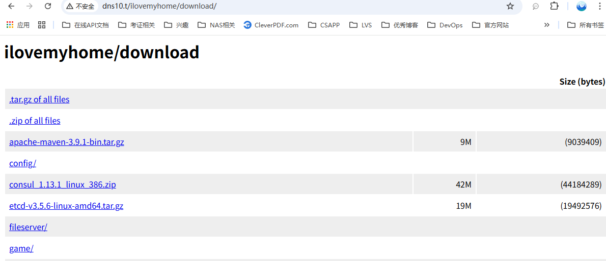

# DNS 以及文件共享服务器配置

DNS服务器作为内部域名服务器。
- 主要的功能就是为内部的主机提供域名解析服务，实现域名自由。
- 文件共享服务，实现文件共享自由。
- 监控服务，实现监控自由。

## 1.服务器规格

```text
OS : RockLinux 10.1, 2CPU, 4G Memory, 200GB SSD Disk
```

| 资源配置情况       | 规格                                 | 说明           |
|--------------|------------------------------------|--------------|
| Architecture | x86_64                             | x86_64架构     |
| CPU          | 2 core                             | 2个CPU核心      |
| Memory       | 4G                                 | 4GB 内存       |
| Storage      | 200GB SSD Disk                     | 200GB SSD 硬盘 |
| Hostname     | dns10.ilovemyhome.top              |              |
| 网络           | NAT,HostOnly                       | NAT 网络       |
| OS           | Rocky Linux 10.0 (Red Quartz)      |              |
| Kernel       | Linux 6.12.0-55.27.1.el10_0.x86_64 |              |

这里可以参考[豆包AI的回答 Rocky Linux 10 查看硬件情况](../80-RockyLinux使用相关/RockyLinux10查看硬件情况.md)
常见的命令包括如下:

```shell
## hostnamectl: 查看系统与硬件架构
[jack@dns10 ~]$ hostnamectl
     Static hostname: dns10.ilovemyhome.top
## lscpu：查看 CPU 详细信息
[jack@dns10 ~]$ lscpu
Architecture:             x86_64
  CPU op-mode(s):         32-bit, 64-bit
  Address sizes:          45 bits physical, 48 bits virtual
  Byte Order:             Little Endian
## free：查看内存使用与总量
[jack@dns10 ~]$ free -h
               total        used        free      shared  buff/cache   available
Mem:           3.5Gi       1.0Gi       2.3Gi        13Mi       511Mi       2.5Gi
Swap:          3.9Gi          0B       3.9Gi
## lsblk：查看磁盘与分区信息
[jack@dns10 ~]$ lsblk
NAME        MAJ:MIN RM   SIZE RO TYPE MOUNTPOINTS
sr0          11:0    1   7.1G  0 rom  
nvme0n1     259:0    0   200G  0 disk 
├─nvme0n1p1 259:1    0     1M  0 part 
## df -h：查看文件系统使用情况
[jack@dns10 ~]$ df -h
Filesystem           Size  Used Avail Use% Mounted on
/dev/mapper/rl-root   70G   13G   58G  18% /
devtmpfs             4.0M     0  4.0M   0% /dev
tmpfs                1.8G     0  1.8G   0% /dev/shm
```

## 2 网络配置情况

网络配置表

| 网卡ID   | 虚拟网络   | 虚拟网络类型   | IP               | 网关         | DNS       |
|--------|--------|----------|------------------|------------|-----------|
| ens224 | VmNet8 | NAT      | 10.10.10.10/8    | 10.10.10.2 | 127.0.0.1 |
| ens160 | VmNet1 | HostOnly | 172.16.10.10/16  | N/A        | N/A       |
| ens256 | VmNet9 | HostOnly | 192.168.10.10/24 | N/A        | N/A       |

路由情况

```shell
[jack@dns10 ~]$ ip route
default via 10.10.10.2 dev ens224 proto static metric 101 
10.0.0.0/8 dev ens224 proto kernel scope link src 10.10.10.10 metric 101 
172.16.0.0/16 dev ens160 proto kernel scope link src 172.16.10.10 metric 100 
192.168.10.0/24 dev ens256 proto kernel scope link src 192.168.10.10 metric 102 
```

## 3. 安装dnsmasq来实现dns自由

Rocky Linux 10.0 中 dnsmasq 的安装非常简单，直接使用 yum 安装即可。
```shell
[root@dns10 ~]$ sudo dnf install -y dnsmasq
```
配置也非常简单，这里贴一下。
```shell
[root@dns10 ~]$ cat /etc/dnsmasq.conf
no-resolv
no-hosts
addn-hosts=/etc/dnsmasq.hosts
server=192.168.0.1
server=114.114.114.114
server=8.8.8.8
cache-size=10000
log-queries

[root@dns10 ~]$ cat /etc/dnsmasq.hosts
# /etc/dnsmasq.hosts
172.16.10.10 dns10.ilovemyhome.top

172.16.10.5 dev5.ilovemyhome.top
172.16.10.6 dev6.ilovemyhome.top
172.16.10.188 app188.ilovemyhome.top
172.16.10.189 app189.ilovemyhome.top

```

这里ilovemyhome.top的域名太长了，打起来太不方便，可以在`/etc/dnsmasq.hosts`配置多条记录来实现。
```shell
[root@dns10 etc]# cat /etc/dnsmasq.hosts 
# /etc/dnsmasq.hosts
172.16.10.10 dns10.ilovemyhome.top

172.16.10.5 dev5.ilovemyhome.top
172.16.10.6 dev6.ilovemyhome.top
172.16.10.188 app188.ilovemyhome.top
172.16.10.189 app189.ilovemyhome.top

172.16.10.10 dns10.t
172.16.10.5 dev5.t
172.16.10.6 dev6.t
172.16.10.188 app188.t
172.16.10.189 app189.t
```
配置完成后，重启 dnsmasq 服务，并查看 dnsmasq 的状态。
```shell
[root@dns10 etc]# systemctl restart dnsmasq.service 
[root@dns10 etc]# 
[root@dns10 etc]# 
[root@dns10 etc]# nslookup dev5.t
Server:		127.0.0.1
Address:	127.0.0.1#53

Name:	dev5.t
Address: 172.16.10.5

[root@dns10 etc]# 
[root@dns10 etc]# nslookup app188.t
Server:		127.0.0.1
Address:	127.0.0.1#53

Name:	app188.t
Address: 172.16.10.188
```


参考资料
- [dnsmasq 官方文档](https://thekelleys.org.uk/dnsmasq/doc.html)
- [豆包AI Rocky Linux 10 安装dnsmasq](../92-安装的系统软件/dnsmasq/RockyLinux10安装和配置dnsmasq.md)
- [豆包AI dnsmasq与其他DNS服务器的区别](../92-安装的系统软件/dnsmasq/dnsmasq与其他DNS服务器的区别.md)

## 4 安装简单的http文件共享服务http-file-server来实现文件共享自由
`http-file-server`是一个用go语言写的非常简单的文件服务，只有一个可执行文件，安装非常简单。

```shell
[jack@dns10 ~]$ sudo cd /tmp \
&& wget https://github.com/sgreben/http-file-server/releases/download/1.6.1/http-file-server_1.6.1_linux_x86_64.tar.gz \
&& tar -zxvf http-file-server_1.6.1_linux_x86_64.tar.gz \
&& mv http-file-server /usr/local/bin/ \
&& type http-file-server
...
http-file-server is hashed (/usr/local/bin/http-file-server)
```

创建一个系统服务，并自动启动。
```shell
[jack@dns10 ~]$ sudo cat << EOF > /etc/systemd/system/http-file-server.service
[Unit]
Description=http-file-server
After=network.target

[Service]
Type=simple
User=root
Group=root
ExecStart=/usr/local/bin/http-file-server -addr :80 /appvol/ilovemyhome
Restart=on-failure

[Install]
WantedBy=multi-user.target

EOF
[jack@dns10 ~]$
[jack@dns10 ~]$ sudo systemctl daemon-reload
[jack@dns10 ~]$ sudo systemctl start http-file-server
[jack@dns10 ~]$ sudo systemctl enable http-file-server
[jack@dns10 ~]$ curl localhost
<a href="/ilovemyhome/">Temporary Redirect</a>.
```

系统界面:


参考资料
- [豆包AI 使用http-file-server搭建一个文件服务器](../92-安装的系统软件/http-file-server/使用http-file-server搭建一个文件共享服务器.md)
- [http-file-server gitHub项目地址](https://github.com/sgreben/http-file-server)

## 5. 安装Keycloak来实现统一身份认证和单点登录

Keycloak 是一个开源的身份和访问管理（IAM）服务，支持 OpenID Connect、OAuth 2.0 和 SAML。
应用接入后，可以统一管理用户、角色和登录会话，实现单点登录（SSO），不需要每个应用都维护一套账号密码。

### 5.1 安装方案

这里采用官方压缩包安装，不使用容器。Keycloak 安装在 `dns10` 上，数据库使用 `db20` 上的 PostgreSQL，
由 systemd 管理生命周期。使用正式启动模式 `start --optimized`，不要使用 `start-dev` 长期运行。

| 项目 | 本文配置 |
|------|----------|
| 操作系统 | Rocky Linux 10，x86_64 |
| Keycloak | 26.8.1，固定版本示例，升级前查看官方兼容性及迁移说明 |
| Java | OpenJDK 21 |
| 数据库 | PostgreSQL 18，`db20.ilovemyhome.top`，`172.16.10.20:5432` |
| 访问地址 | `https://sso.ilovemyhome.top:8443` |
| 监听地址 | `172.16.10.10:8443`，只监听 HostOnly 网卡 |
| 安装目录 | `/appvol/ilovemyhome/runtime/keycloak-26.8.1` |
| 当前版本软链接 | `/appvol/ilovemyhome/runtime/keycloak` |
| 配置目录 | `/appvol/ilovemyhome/config/keycloak` |
| 运行用户 | `keycloak`，禁止交互登录 |
| 日志 | systemd journal |

使用 8443 是为了避免与第 4 章的 HTTP 文件共享服务占用的 80 端口冲突，也不需要让 Keycloak 使用 root 身份运行。
当前方案是家庭内网单节点部署，不包含高可用；4GB 内存还需要与 DNS、文件服务和后续监控服务共享，注意监控内存使用。

下面除了注明在 `db20` 上执行的命令以外，都在 `dns10` 上执行。
先通过 `sudo -i` 进入 root 的 Bash 会话，后续安装命令均在这个会话中执行。


### 5.2 配置域名和 Java 环境

在 `/etc/dnsmasq.hosts` 中添加下面的记录，不要覆盖已有内容：

```text
172.16.10.10 sso.ilovemyhome.top
```

检查并重启 DNS 服务：

```bash
dnsmasq --test && systemctl restart dnsmasq
getent hosts sso.ilovemyhome.top
getent hosts db20.ilovemyhome.top
```

两个域名应分别解析为 `172.16.10.10` 和 `172.16.10.20`。
访问 Keycloak 的客户端也需要使用这台 DNS 服务器；临时测试时可以在客户端 hosts 文件中添加相同记录。
统一使用完整的 `sso.ilovemyhome.top` 域名，不要混用 IP、`dns10.t` 等别名，否则会影响证书校验、重定向和 Token 的 issuer。

安装 Java 和必要工具：

```bash
dnf install -y java-21-openjdk-headless curl tar openssl
/usr/lib/jvm/jre-21-openjdk/bin/java -version
```

systemd 不会读取个人的 `.bashrc`，因此后面的服务配置会显式指定 `JAVA_HOME`。
如果使用自己安装的 JDK 21，需要同步修改构建命令和服务文件中的路径。

### 5.3 准备 PostgreSQL 数据库

先按照 [PostgreSQL 安装和配置指南](../92-安装的系统软件/postgresql/README.md) 启动 `db20` 上的数据库。
这里创建独立数据库和非超级用户，不使用现有的数据库管理员账号运行 Keycloak。

在 **db20** 上，以现有的数据库管理用户执行：

```bash
source /appvol/ilovemyhome/bin/set_pg_envs.sh
"$PG_BIN/psql" -h localhost -p 5432 -U jack -d postgres
```

在 psql 中执行，`\password` 会交互式设置密码，避免将密码写进 SQL 历史：

```sql
SET password_encryption = 'scram-sha-256';
CREATE ROLE keycloak LOGIN NOSUPERUSER NOCREATEDB NOCREATEROLE;
\password keycloak
CREATE DATABASE keycloak OWNER keycloak ENCODING 'UTF8' TEMPLATE template0;
\q
```

使用密码管理器生成独立的强密码，稍后填入 `KC_DB_PASSWORD`。
为避免配置表达式和转义问题，本例建议使用 `openssl rand -hex 32` 生成的随机密码，不要使用文档示例密码。

找到实际生效的数据库配置文件：

```bash
"$PG_BIN/psql" -h localhost -p 5432 -U jack -d postgres \
  -c 'SHOW config_file;' -c 'SHOW hba_file;' -c 'SHOW listen_addresses;'
```

确认 PostgreSQL 正在监听 `172.16.10.20`（已有配置 `listen_addresses = '*'` 也包含这个地址）。
在实际的 `pg_hba.conf` 中，将下面的规则添加到已有宽泛规则**之前**，因为 PostgreSQL 使用第一条匹配的规则：

```text
host    keycloak    keycloak    172.16.10.10/32    scram-sha-256
```

重新加载认证规则：

```bash
"$PG_BIN/psql" -h localhost -p 5432 -U jack -d postgres \
  -c 'SELECT pg_reload_conf();'
```

如果修改了 `listen_addresses`，还需要使用原有管理脚本重启 PostgreSQL，单纯 reload 不够。
若 `db20` 启用了 firewalld，在 HostOnly 网卡所属的实际 zone 中允许来自 `172.16.10.10/32` 的 TCP 5432 访问。
先用 `firewall-cmd --get-active-zones` 确认 zone，再添加限定来源的 rich rule，不要为了此服务开放整个网段或公网访问。
已有宽泛的防火墙及数据库认证规则也需要单独收紧，新增精确规则不会自动撤销已有授权。

> 本文后面的 JDBC URL 使用 `sslmode=disable`，仅用于隔离的家庭实验网络，数据库链路不加密。
> 正式部署或跨不可信网络时，应先为 PostgreSQL 配置 TLS，使用数据库域名连接，
> 将 JDBC 参数改为 `sslmode=verify-full&sslrootcert=/appvol/ilovemyhome/config/keycloak/db-ca.crt`，
> 并将签发数据库证书的 CA 文件放到该路径，确保 `keycloak` 用户可读。数据库证书必须包含对应域名。
> 此时也应将认证规则改为 `hostssl`，并禁止该账号的非 TLS 连接。

### 5.4 下载并安装 Keycloak

在 **dns10** 的 root Bash 会话中执行。下面是首次安装步骤，如果目录或用户已经存在，先检查现有安装，不要直接覆盖：

```bash
useradd --system --user-group \
  --home-dir /appvol/ilovemyhome/runtime/keycloak \
  --no-create-home --shell /sbin/nologin keycloak

install -d -m 0755 /appvol/ilovemyhome/download
install -d -m 0755 /appvol/ilovemyhome/runtime
install -d -o root -g keycloak -m 0750 /appvol/ilovemyhome/config/keycloak
```

下载官方发布包及校验文件，校验成功后再解压：

```bash
(
  set -e
  KC_VERSION=26.8.1
  cd /appvol/ilovemyhome/download
  curl -fLO "https://github.com/keycloak/keycloak/releases/download/${KC_VERSION}/keycloak-${KC_VERSION}.tar.gz"
  curl -fLO "https://github.com/keycloak/keycloak/releases/download/${KC_VERSION}/keycloak-${KC_VERSION}.tar.gz.sha1"
  printf '%s  %s\n' "$(cat "keycloak-${KC_VERSION}.tar.gz.sha1")" \
    "keycloak-${KC_VERSION}.tar.gz" | sha1sum --check -
  tar -xzf "keycloak-${KC_VERSION}.tar.gz" -C /appvol/ilovemyhome/runtime
  chown -R keycloak:keycloak "/appvol/ilovemyhome/runtime/keycloak-${KC_VERSION}"
  ln -s "/appvol/ilovemyhome/runtime/keycloak-${KC_VERSION}" \
    /appvol/ilovemyhome/runtime/keycloak
)
```

确认校验输出为 `OK`，且整个命令组没有报错后再继续。SHA-1 文件是官方提供的下载完整性校验，不等同于发布者签名验证。
如果修改版本号，应同时检查该版本支持的 Java 和 PostgreSQL 版本。
确认 `keycloak` 用户能够穿过 `/appvol` 下的所有父目录，不要通过 `chmod -R 777` 解决权限问题。

### 5.5 配置 HTTPS 和服务参数

正式使用时，优先准备由客户端信任的 CA 签发的证书，证书 SAN 必须包含 `sso.ilovemyhome.top`。
将 PEM 格式的完整证书链和不带口令的私钥分别放到下面的 `tls.crt`、`tls.key` 路径。

如果暂时没有 CA，可以在家庭实验环境中生成一张有效期为一年的自签名证书：

```bash
openssl req -x509 -newkey rsa:3072 -sha256 -noenc -days 1024 \
  -keyout /appvol/ilovemyhome/config/keycloak/tls.key \
  -out /appvol/ilovemyhome/config/keycloak/tls.crt \
  -subj "/CN=sso.ilovemyhome.top" \
  -addext "subjectAltName=DNS:sso.ilovemyhome.top" \
  -addext "extendedKeyUsage=serverAuth"

chown root:keycloak /appvol/ilovemyhome/config/keycloak/tls.{crt,key}
chmod 0640 /appvol/ilovemyhome/config/keycloak/tls.{crt,key}
```

自签名证书默认不受浏览器和应用信任，需要在客户端按其证书信任机制显式信任，或换成受信任 CA 签发的证书。
只分发公有证书，不要分发 `tls.key`，也不要在应用中关闭证书校验。

创建主配置文件：

```bash
cat > /appvol/ilovemyhome/config/keycloak/keycloak.conf <<'EOF'
db=postgres
db-url=jdbc:postgresql://db20.ilovemyhome.top:5432/keycloak?sslmode=disable
db-username=keycloak
db-pool-initial-size=2
db-pool-min-size=2
db-pool-max-size=10

hostname=https://sso.ilovemyhome.top:8443
http-enabled=false
http-host=172.16.10.10
https-port=8443
https-certificate-file=/appvol/ilovemyhome/config/keycloak/tls.crt
https-certificate-key-file=/appvol/ilovemyhome/config/keycloak/tls.key

cache=local
health-enabled=true
metrics-enabled=true
http-management-host=127.0.0.1
http-management-port=9000
http-management-scheme=http
log=console
EOF

chown root:keycloak /appvol/ilovemyhome/config/keycloak/keycloak.conf
chmod 0640 /appvol/ilovemyhome/config/keycloak/keycloak.conf
install -o root -g root -m 0600 /dev/null /appvol/ilovemyhome/config/keycloak/keycloak.env
```

使用 `vi /appvol/ilovemyhome/config/keycloak/keycloak.env` 填入以下内容，将两处占位符替换为真实的强密码。
数据库密码必须与第 5.3 节一致，临时管理员使用另一份独立密码：

```ini
KC_DB_PASSWORD=REPLACE_WITH_DATABASE_PASSWORD
KC_BOOTSTRAP_ADMIN_USERNAME=bootstrap-admin
KC_BOOTSTRAP_ADMIN_PASSWORD=REPLACE_WITH_TEMPORARY_ADMIN_PASSWORD
JAVA_OPTS_KC_HEAP=-Xms256m -Xmx768m
```

这个文件由 systemd 以 root 身份读取后传递给服务，不需要让运行用户直接读取。
不要提交到 Git、复制进聊天记录或放进公开的 `share` 目录。
证书私钥、密码文件、数据库数据和备份都不能通过文件服务下载。

### 5.6 构建并配置 systemd 服务

先执行优化构建。数据库类型、健康检查和指标开关属于构建配置，后续修改这些选项后需要重新构建：

```bash
runuser -u keycloak -- env JAVA_HOME=/usr/lib/jvm/jre-21-openjdk \
  /appvol/ilovemyhome/runtime/keycloak/bin/kc.sh \
  --config-file=/appvol/ilovemyhome/config/keycloak/keycloak.conf build
```

创建服务：

```bash
cat > /etc/systemd/system/keycloak.service <<'EOF'
[Unit]
Description=Keycloak Identity and Access Management
Wants=network-online.target
After=network-online.target

[Service]
Type=simple
User=keycloak
Group=keycloak
WorkingDirectory=/appvol/ilovemyhome/runtime/keycloak
Environment=JAVA_HOME=/usr/lib/jvm/jre-21-openjdk
EnvironmentFile=/appvol/ilovemyhome/config/keycloak/keycloak.env
ExecStart=/appvol/ilovemyhome/runtime/keycloak/bin/kc.sh --config-file=/appvol/ilovemyhome/config/keycloak/keycloak.conf start --optimized
Restart=on-failure
RestartSec=10
TimeoutStartSec=300
TimeoutStopSec=60
UMask=0027
NoNewPrivileges=true
PrivateTmp=true
ProtectHome=true

[Install]
WantedBy=multi-user.target
EOF

systemctl daemon-reload
systemctl enable --now keycloak
systemctl status keycloak --no-pager
journalctl -u keycloak -n 100 --no-pager
```

首次启动会初始化数据库，可能需要等待一段时间。`active` 仅表示进程运行，是否就绪还要检查下一节的健康接口。
远程数据库不属于本机 systemd 服务，`After=network-online.target` 不保证数据库已经可用。
如果启动失败，先查看日志和数据库连通性，修复后执行 `systemctl restart keycloak`。

若启用了 firewalld，先通过 `firewall-cmd --get-active-zones` 查出 HostOnly 网卡 `ens160` 所在的 zone。
以下以 `public` 为例，只有确认实际 zone 后才执行，限制为家庭 HostOnly 网段访问：

```bash
firewall-cmd --permanent --zone=public \
  --add-rich-rule='rule family="ipv4" source address="172.16.0.0/16" port port="8443" protocol="tcp" accept'
firewall-cmd --reload
```

不需要开放 8080 或 9000；管理接口只绑定 `127.0.0.1`。保留 SELinux Enforcing，不要通过关闭 SELinux 或防火墙绕过报错。
若有权限拒绝，先检查文件权限、`journalctl` 和 `ausearch -m AVC -ts recent`，再针对实际拒绝调整标签或策略。

### 5.7 验证服务并完成管理员初始化

在 `dns10` 上检查就绪状态：

```bash
curl --fail --silent --show-error http://127.0.0.1:9000/health/ready
```

应返回 HTTP 200，JSON 中的 `status` 为 `UP`。这里启用了 metrics，因此也会包含数据库连接健康检查。
再使用受信任的证书验证 OIDC 发现接口，而不只是检查端口是否打开：

```bash
curl --fail --silent --show-error \
  --cacert /appvol/ilovemyhome/config/keycloak/tls.crt \
  https://sso.ilovemyhome.top:8443/realms/master/.well-known/openid-configuration
```

自签名示例可以直接将 `tls.crt` 作为本次请求的信任锚。
如果使用 CA 签发的证书，`--cacert` 应改成对应的 CA 证书文件，或在系统已信任该 CA 时省略此参数。
返回 JSON 中的 `issuer` 应为 `https://sso.ilovemyhome.top:8443/realms/master`。
还应从实际客户端验证 DNS、证书信任及网络访问，不能只在服务器本机测试。

浏览器访问 `https://sso.ilovemyhome.top:8443/admin/`，使用前面配置的临时管理员登录。
该账号只会在数据库中尚未创建 `master` realm 的首次启动时创建，后续修改环境变量不会重置已有管理员密码。

完成以下初始化：

1. 在 `master` realm 创建一个正式管理员，设置强密码，分配 `admin` realm role，并配置 OTP 等多因素认证。
2. 使用另一个浏览器会话确认正式管理员可以登录和管理，再删除 `bootstrap-admin` 临时账号。
3. 编辑 `keycloak.env`，删除 `KC_BOOTSTRAP_ADMIN_USERNAME` 和 `KC_BOOTSTRAP_ADMIN_PASSWORD` 两行，保留数据库密码与堆内存配置，然后执行 `systemctl restart keycloak`。
4. 新建业务 realm，例如 `ilovemyhome`，业务用户和应用放在这个 realm 中，不要使用 `master` 承载业务。

### 5.8 应用接入单点登录

在 `ilovemyhome` realm 中创建 OpenID Connect Client。不同应用使用不同的 Client ID。
以服务端 Web 应用为例，启用 `Client authentication` 和 `Standard flow`，
只填写应用真实的回调地址，例如 `https://app.example.com/oidc/callback`，不要使用任意域名通配符。
Client Secret 只保存在后端，不要放进前端代码或 Git。

如果是 SPA 或其他不能保密的公共客户端，应关闭 Client authentication，使用 Authorization Code Flow + PKCE（S256），
不要把服务端应用的 Secret 配置照搬到浏览器。
`Web origins` 按应用需要填写准确的源地址，不要为了绕过 CORS 配置成 `*`。

应用使用的 issuer 为：

```text
https://sso.ilovemyhome.top:8443/realms/ilovemyhome
```

OIDC 发现地址为：

```text
https://sso.ilovemyhome.top:8443/realms/ilovemyhome/.well-known/openid-configuration
```

在业务 realm 创建测试用户并设置密码后，分别接入两个应用验证：第一个应用登录成功，第二个应用跳转到 Keycloak 时无需再次输入密码。
应用仍然需要正确实现权限校验、会话过期和退出登录；只安装 Keycloak 不会自动让所有应用支持 SSO。

### 5.9 日常管理、备份和常见问题

```bash
systemctl start keycloak
systemctl stop keycloak
systemctl restart keycloak
systemctl status keycloak --no-pager
journalctl -u keycloak -f
```

| 现象 | 排查方向 |
|------|----------|
| Java 版本不正确或找不到 Java | 检查服务中的 `JAVA_HOME`，不要只看当前登录用户的 `java -version` |
| 数据库连接失败 | 检查 db20 状态、DNS、5432 防火墙规则、`pg_hba.conf` 顺序、数据库名及密码 |
| HTTPS 证书报错 | 检查证书 SAN、有效期、完整证书链以及客户端是否信任签发 CA |
| 登录后回调失败或 issuer 不一致 | 检查固定 hostname、应用 issuer、Client 回调地址，确保使用同一完整域名和端口 |
| 临时管理员无法创建 | 检查数据库是否已有 `master` realm；不要删库重建，按官方管理员恢复流程处理 |
| 进程被 OOM 杀死 | 检查系统日志及内存占用，适当调整 Java 堆或增加内存，堆大小不等于进程总内存 |

定期备份 PostgreSQL 中的 `keycloak` 数据库，以及配置、证书、私钥和自定义 provider/theme。
Realm 导出不能替代完整数据库备份。备份中包含敏感数据，应加密保存并限制访问，且要实际演练恢复。
升级前先停止 Keycloak 写入并制作一致的数据库备份，在测试环境验证迁移；
数据库 schema 升级后，不能假设只切回旧版本软链接就能回滚，需要结合升级前的数据库备份恢复。

参考资料：

- [Keycloak 官方下载](https://www.keycloak.org/downloads)
- [Keycloak 支持的运行环境与数据库版本](https://www.keycloak.org/server/supported-configurations)
- [Keycloak 配置指南](https://www.keycloak.org/server/configuration)
- [Keycloak 数据库配置](https://www.keycloak.org/server/db)
- [Keycloak HTTPS 配置](https://www.keycloak.org/server/enabletls)
- [Keycloak hostname 配置](https://www.keycloak.org/server/hostname)
- [Keycloak 健康检查](https://www.keycloak.org/observability/health)
- [Keycloak 临时管理员及访问恢复](https://www.keycloak.org/server/bootstrap-admin-recovery)

## 6. 安装prometheus和grafana来实现监控自由
